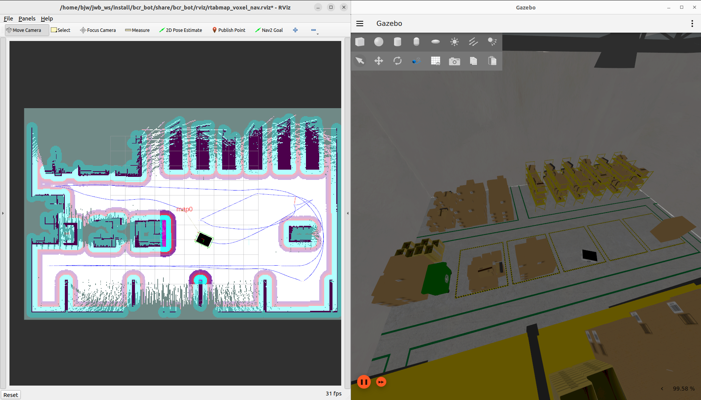
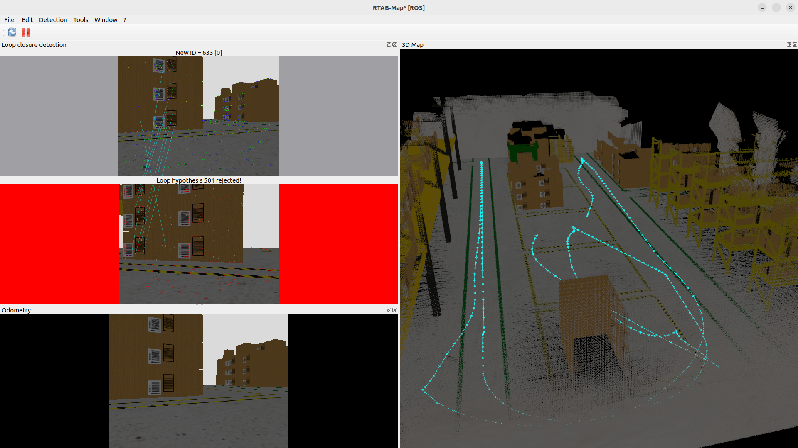

# vslam_bringup

ROS 2 package for spawning BCR Bot with an RGB-D sensor bridge and running
RTAB-Map SLAM and Nav2. The robot URDF, meshes, and simulation worlds come from
the `bcr_bot` package. The model in `bcr_bot` must use `rgbd_camera` in place of
the Kinect sensor for Gazebo Fortress/Harmonic.

## Screenshots

Gazebo simulation alongside the Nav2 costmap and robot trajectory in RViz.



RTAB-Map RGB-D mapping with a 3D point cloud and estimated trajectory.



## Build

Place both repositories under `src/` in the same workspace. Run the following
commands in a terminal with the ROS 2 and Nav2 environments sourced.

```bash
cd ~/jwb_ws
rosdep install --from-paths src/bcr_bot src/vslam_bringup --ignore-src -r -y
colcon build --packages-select bcr_bot vslam_bringup
source install/setup.bash
```

## Run

Run `source ~/jwb_ws/install/setup.bash` in each terminal.

Start the robot and RGB-D bridge in Gazebo Fortress:

```bash
ros2 launch vslam_bringup ign.launch.py camera_enabled:=true stereo_camera_enabled:=false
```

For Gazebo Harmonic, use `gz.launch.py` with the same arguments.
If the simulator is already running, use the spawn launch below instead of the
world launch. If the robot and sensor bridge are also running, skip the spawn
launch.

```bash
ros2 launch vslam_bringup bcr_bot_ign_spawn.launch.py
# Harmonic: bcr_bot_gz_spawn.launch.py
```

Create an RGB-D map with RTAB-Map. Specifying an existing database resumes
mapping, so use a new database path to start a fresh map.

```bash
ros2 launch vslam_bringup rtabmap_robust.launch.py \
  database_path:=$HOME/.ros/bcr_bot_rtabmap_robust.db
```

To run Nav2 with localization against a saved database, stop any separately
launched RTAB-Map instance, then run the command below. The database is opened
in read-only mode.

```bash
ros2 launch vslam_bringup rtabmap_voxel_nav.launch.py
```

To connect Nav2 to an existing RTAB-Map instance, set `start_rtabmap:=false`.

## Files

- `launch/ign.launch.py`, `launch/gz.launch.py`: launch the world and spawn the RGB-D robot.
- `launch/bcr_bot_*_spawn.launch.py`: spawn the robot and start TF and Gazebo/ROS sensor bridges.
- `launch/rtabmap_robust.launch.py`: RGB-D SLAM using external odometry.
- `launch/rtabmap_voxel_nav.launch.py`: RTAB-Map and Nav2 with a voxel costmap.
- `config/`, `rviz/`, `scripts/`: Nav2 settings, filtered maps, RViz configurations, and a velocity relay.

See [RGB-D Camera](docs/rgbd_camera.md) for camera topics and
[RTAB-Map + Nav2](docs/rtabmap_voxel_nav.md) for localization, mapping, and
filtered map usage.

The spawn/world launch files and `remapper.py` were adapted from
[bcr_bot](https://github.com/blackcoffeerobotics/bcr_bot), licensed under
Apache-2.0. Models and worlds are installed through `bcr_bot`.
